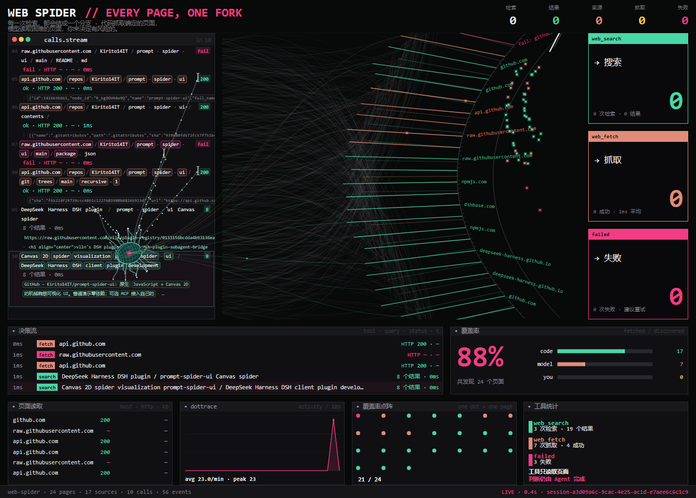
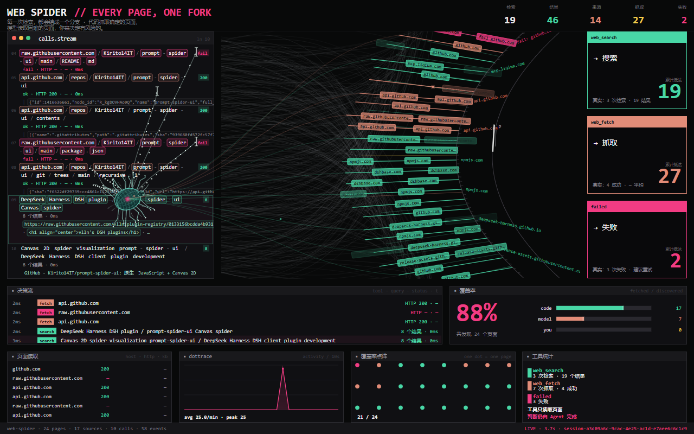
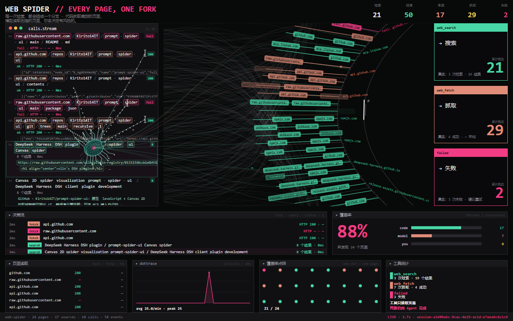
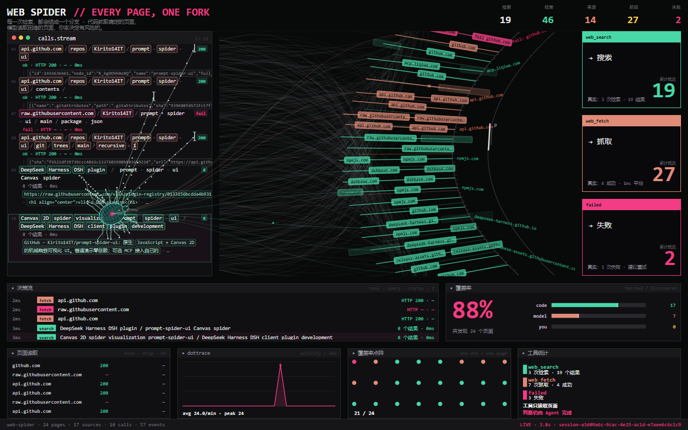

# DSH Sidebar Spider · 侧栏蛛网 / 检索大屏

一个 **DeepSeek Harness（DSH）桌面版的客户端插件**：对话进行中，智能体每次调用 `web_search` / `web_fetch`，
右侧栏的「蛛网」标签页会**实时**把检索过程画成一张 Canvas 2D 蛛网；把面板展开成全屏，就是完整的**检索大屏**模式。



---

## 功能

**两种呈现（同一条实时数据流）**

| 面板宽度 | 呈现 |
|---|---|
| 窄侧栏（< 720px） | **紧凑蛛网**：Canvas 蜘蛛 + 页面节点 + 蛛网，左下角有 `⤢ 大屏` 按钮 |
| 宽 / 全屏（≥ 720px） | **检索大屏**：左侧数据流、中间蛛网、右侧卡片、底部多面板 |

**检索大屏里发生了什么**

- **左侧数据流 = 爬取的数据本身**：每行一次真实动作，`search` 行是完整搜索词 + 结果标题，`fetch` 行是 URL + HTTP 状态 + 抓取到的页面正文摘录（带彩色 token 方框）。
- **数据流缓慢上滑**（约 14 px/s、无缝循环）：蜘蛛停在下方锚点区，像趴在一条流动的数据带上；**只有触手扫过的那几行才会亮起方框**，滑过去后恢复纯文本。

  
  

- **传输路径上的标签是流式的**：每个页面的标签沿连线由内向外循环流动（淡入淡出 + 彗尾），不是固定贴纸。
- **数字随抵达持续叠加**：标签每抵达一次终点，顶部五格统计与右侧三张卡就 `+1`，没有上限、不会停；卡片大数字旁标注「累计抵达」，**卡片脚注与底部状态栏保留真实总量**（`真实：3 次检索 · 19 结果` 等）。

  

- 中间：蛛网扇形 + 扫描器 + 线框蜘蛛（Canvas 引擎模块）。
- 右侧：`搜索 / 抓取 / 失败` 三张计数卡；底部：`决策流`、`覆盖率`、`页面读取`、`dottrace`、`覆盖率点阵`、`工具统计`。
- 交互：点击节点/数据可在右侧栏「浏览器」标签页打开对应网页（未启用则退回系统浏览器）；蛛网 tab 可拖宽、分栏、全屏。

**数据从哪来**：插件订阅当前会话的实时事件窗口（与内置工具卡片同源）——
`tool/call` 的 `web_search`（queries）、`web_fetch`（url）与 `tool/result` 的 `meta.sources` / `meta.statusCode`
（结果 URL、标题、摘要、HTTP 状态、页面正文）。数据仅存在于浏览器内存、按会话隔离，**不上传任何内容**。

---

## 安装（DSH 桌面版）

环境：已安装并启动过 DSH 桌面版（Windows 上测试版本 `0.2.1-rc.3`），右侧栏已可用。

1. 下载/克隆本仓库到任意本地目录（路径不要删，插件按绝对路径加载）。
2. **推荐**：在本仓库根目录运行

   ```powershell
   powershell -ExecutionPolicy Bypass -File .\install.ps1
   ```

   它会：
   - 校验 `plugin\lib\index.js` 存在；
   - 在 `%USERPROFILE%\.dsh\profiles\desktop\cordis.patch.yml` 末尾追加一条本地插件加载记录（已存在则跳过）；
   - 自动备份原文件为 `cordis.patch.yml.bak-<时间戳>`。

3. DSH 的 HMR 会在 1–3 秒内热加载插件（**无需重启应用**；没看到就刷新一下页面）。
4. 打开方式：右侧栏 tab 条 `+` → 开始页里点「**蛛网**」；或在当前会话第一次联网检索时自动打开一次。

**手动安装**（等价于脚本）：在 `%USERPROFILE%\.dsh\profiles\desktop\cordis.patch.yml` 末尾追加

```yaml
- insert:
    - id: ui-sidebar-spider
      name: 'file:///D:/path/to/dsh-sidebar-spider/plugin/lib/index.js'
```

（把路径换成本仓库 `plugin\lib\index.js` 的绝对路径，注意写成 `file:///` + 正斜杠。）

### 卸载

```powershell
powershell -ExecutionPolicy Bypass -File .\uninstall.ps1
```

或手动删除 `cordis.patch.yml` 末尾以 `# Sidebar Spider plugin` 开头的那段 `- insert:` 记录；HMR 会立即卸载。

---

## 仓库结构

```
plugin/                 DSH 客户端插件（安装单元：package.json + lib/）
  lib/index.js          host 端空实现（Loader 需要一个合法 Cordis 插件）
  lib/client.js         ★ 实际生效的浏览器端 bundle（内联了下方两个 Canvas 组件）
  src/plugin.js         插件源码：侧栏 tab、会话事件折叠、紧凑/大屏切换、自动打开
  build.mjs             把 embed/ 与 scene/ 的组件内联进 lib/client.js
  verify.mjs            离线自测（36 项：注册、事件折叠、非 web 结果过滤、SSR、清理）
  collector.mjs         可选：本地验证收集器（默认不启用，见「隐私」）
  install.ps1 / uninstall.ps1
embed/                  紧凑蛛网组件（自包含 Canvas widget，含离线 demo/自测）
  spider-widget.js       生成产物：createSpiderView(container, options)
  src/widget.js          组合层源码（Canvas 引擎模块由 build 内联）
  build/build-widget.mjs 从 vendor/canvas-engine 生成 spider-widget.js
scene/                  检索大屏组件（自包含 Canvas scene，含 mock demo / Skia 渲染 / 自测）
  scene.js               生成产物：createSpiderScene(container, options)
  src/scene-dashboard.js 大屏版式组合层源码
  build/build-scene.mjs  从 vendor/canvas-engine 生成 scene.js
  SCENE-API.md           大屏组件 API / 数据模型 / 渲染规则文档
vendor/canvas-engine/   构建用的 Canvas 2D 渲染模块（MIT）
docs/                   截图
```

---

## 构建

需要 Node.js 22+（本仓库用 v24 验证）。

```powershell
# 只重建插件 bundle（使用仓库里已生成的 embed/spider-widget.js 与 scene/scene.js）
cd plugin
node build.mjs
node verify.mjs        # 36 项自测必须全过 → 输出 lib/client.js

# 可选：从 vendor/canvas-engine 重新生成两个 Canvas 组件
cd ..\embed; node build\build-widget.mjs
cd ..\scene; node build\build-scene.mjs
```

- 生成组件需要 `vendor/canvas-engine/app/*.js`（已内置；构建脚本会对每个模块做 SHA-256 校验，见 `embed/build/engine-lock.json` 与 `scene/build/build-scene.mjs`）。
- 可选自测：`embed\demo\verify-widget.mjs`（15 项，自带 fake DOM/canvas）与
  `scene\demo\verify-scene.mjs`（11 项，需 `npm i -D @napi-rs/canvas` 做真实 Skia 渲染）。
- 改完代码让运行中的 DSH 热加载：修改 `plugin/lib/client.js` 的 mtime 即可（`(Get-Item ...).LastWriteTime = Get-Date`），
  1–3 秒内生效，无需重启。

---

## 实现要点（给维护者）

- **插件形态**：DSH 客户端插件 = `package.json` 声明 `dsh.client.platform = "web"` + `exports["./client"]`，
  浏览器端 bundle 固定为惰性 CJS：`window.__ModuleLoader__.load({ id: <package name>, factory })`，
  其中 `id` 必须等于包名；`require("react")` 走 shell 的共享模块表。
- **侧栏扩展点**：`ctx.sidebarRightTabs.register({ id, kind, title, guide })` 声明 tab 类型，
  `ctx.slots.register({ name: "sidebar.right.pane.tab", key: <id> }, Body)` 注册正文，
  `ctx.sidebarRight.openTab(kind)` 打开；`ctx.sidebarRight.commandTarget(null)` + `toggleFullscreen(target)`
  可一键切全屏（紧凑版的 `⤢ 大屏` 按钮）。
- **实时数据**：`ctx.sessions.binding(sessionId).eventSource` 是浏览器端实时事件窗口（`tool/call` / `tool/result` / `turn/*`），
  与内置工具 UI 同源；插件把它折叠成"研究模型"（calls / pages / metrics / activities）后同时喂给紧凑与大屏两个组件。
- **安装方式**：profile patch 里的 `- insert:` 行以 `file:///` 绝对路径加载本地插件；DSH HMR 监听 profile 文件，
  因此追加即热加载、删除即卸载，不需要 pnpm、node_modules 或重启应用。
- **大屏组件**：纯 Canvas（无 DOM/CSS），`setData(model)` 全量驱动；扫描框、流式标签、累计计数、自动上滑都是
  `animationTime + model` 的纯函数，因此可确定性截图（`getState().scan` 暴露扫描状态）。

---

## 隐私

- 插件只读取**当前会话**的实时事件（页面标题/URL/摘要/抓取正文摘录），数据仅存在浏览器内存、按会话隔离；
  除 DSH 自身发给模型的请求外，不上传任何内容。
- `collector.mjs` 是可选的开发验证工具：仅在本地 `127.0.0.1:4780` 有进程监听时，插件才会上报诊断与
  canvas 截图用于回归验证；平时只有一次失败的 `/health` 探测，无网络副作用。

---

## 已知限制

- 只适配**深色主题**（蜘蛛配色为 teal/pink 硬件风）。
- 画布 DPR 上限 2；大屏组件无鼠标交互（轨道视图/3D 覆盖率球未实现，见 `scene/SCENE-API.md`）。
- 数据行里的页面正文摘录来自 `web_fetch` 返回文本（截断 360 字符）。
- 自动打开每会话一次；被手动关闭后不会再弹。
- 扫描/滚动动画**只在面板可见时播放**（Chromium 后台暂停 RAF，回来继续）。
- 插件目录必须留在安装位置（profile 里记录的是绝对路径）。

---

## 许可

MIT，Copyright (c) 2026 yanx215241-a11y。完整文本见 [LICENSE](LICENSE)。

- 仓库内全部代码（插件骨架、事件折叠、紧凑蛛网与大屏组合层、Canvas 2D 渲染模块）均为本仓库代码，以 MIT 许可发布。
- 仓库地址：<https://github.com/yanx215241-a11y/dsh-sidebar-spider>
- 作者主页：<https://github.com/yanx215241-a11y>

---

## 发布到 GitHub（把本仓库上传）

仓库已包含 `.gitignore` / `LICENSE`，构建产物（`plugin/lib/client.js`、`embed/spider-widget.js`、`scene/scene.js`）已生成，可直接作为独立仓库发布。

**方式 A：命令行（推荐）**

```powershell
cd dsh-sidebar-spider
git init -b main
git add -A
git commit -m "feat: DSH Sidebar Spider client plugin"
git remote add origin https://github.com/yanx215241-a11y/dsh-sidebar-spider.git
git push -u origin main
```

**方式 B：网页上传**

1. GitHub 新建空仓库（不要勾选 README/LICENSE）；
2. 把本目录内容（不含 `.git`）拖到 "uploading an existing file" 页面，或先解压随附的 `dsh-sidebar-spider.zip` 再拖；
3. commit。

> `plugin/package.json` 里的 `repository` / `homepage` / `bugs` 暂按 `yanx215241-a11y/dsh-sidebar-spider` 填写，账号或仓库名不同的话改一下即可。

---

## English summary

A DeepSeek Harness (DSH) desktop **client plugin** that adds a right-sidebar “Spider” tab visualizing the
agent's `web_search` / `web_fetch` activity live on a Canvas. In the narrow sidebar it shows a compact spider
web; when the panel goes fullscreen it becomes a research dashboard: a slowly auto-scrolling stream of the
crawled data with the spider sitting on it and boxes lighting up only where its tentacles reach, streaming
path labels, and counters that keep accumulating per label arrival (real totals stay in the card footnotes).

Install: append one `- insert:` row to `%USERPROFILE%\.dsh\profiles\desktop\cordis.patch.yml` pointing at
`plugin/lib/index.js` (or run `install.ps1`); DSH hot-reloads the plugin in seconds. Build with
`node plugin/build.mjs`, self-test with `node plugin/verify.mjs`. MIT licensed.
